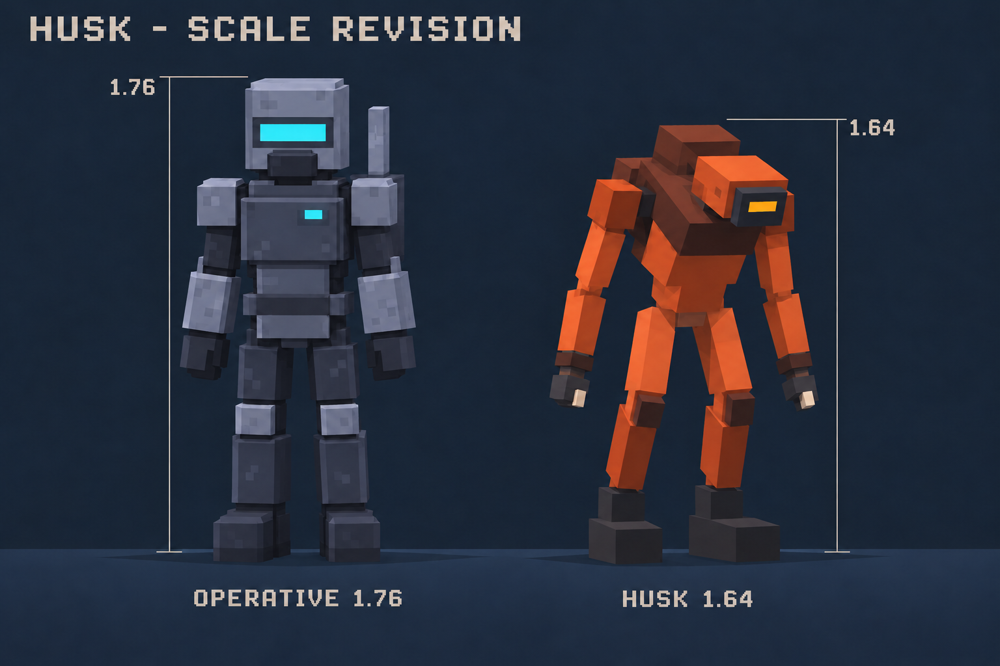
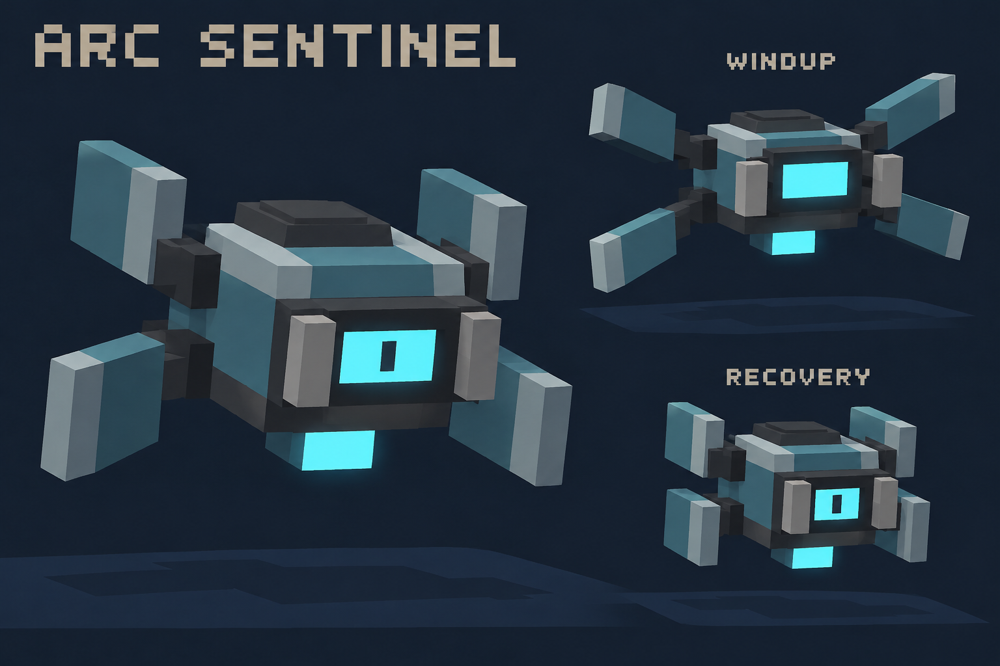
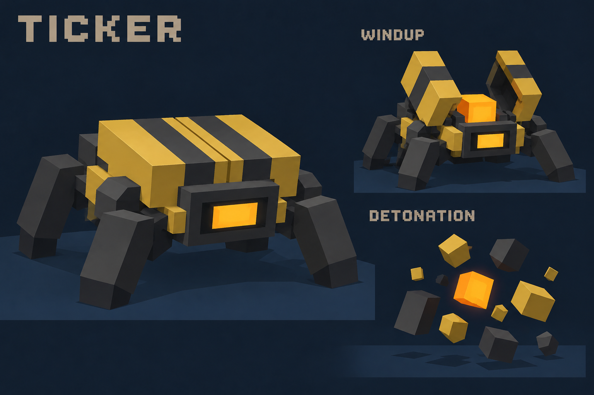
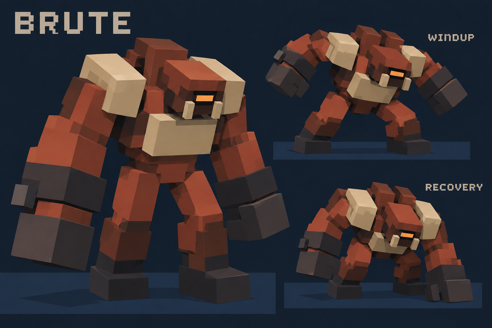
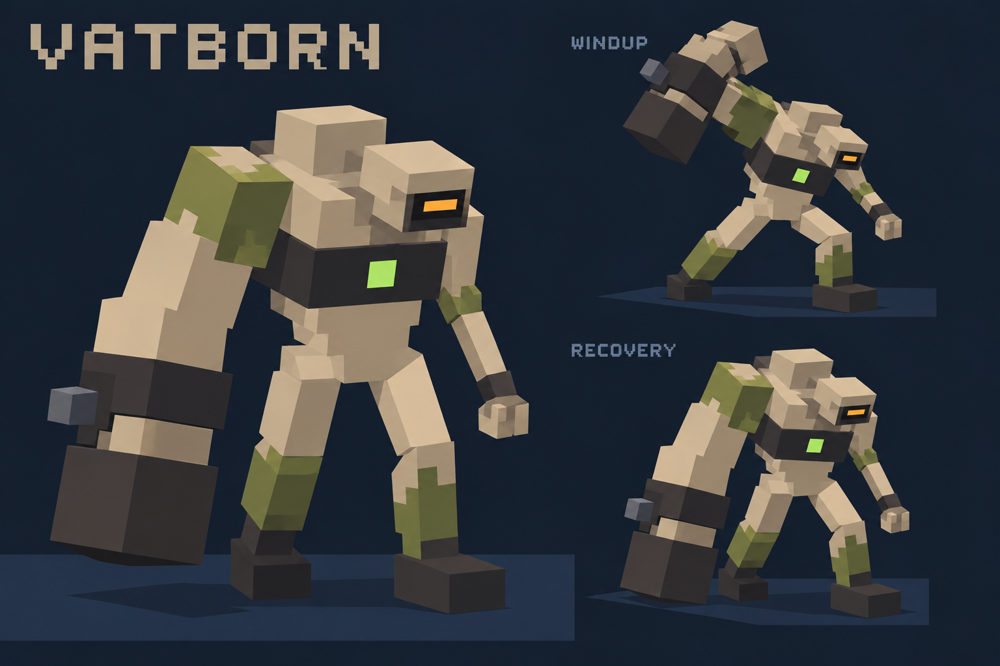

# Current enemy upgrades: voxel models, behavior and attacks

Status: **implemented 2026-10-18** in [enemies.ts](../src/entities/enemies.ts) (rigs, `SCHED` phases, target/facing lock, `meleeStrike`, swept `sweepCommitted` moves, `painAllowed`, planted separation). The snapshot format in `netplay.ts` was not extended: clients derive phase from state + time with the same `SCHED` table, which covers every cue except a charge that ends early (that arrives as a state change). Browser validation from the list at the end is still to be run. Design created 2026-10-18 from the implemented enemy rigs and AI in [enemies.ts](../src/entities/enemies.ts), projectile handling in [projectiles.ts](../src/entities/projectiles.ts), and the Sector 4 tank controller in [biofoundry.ts](../src/preview/biofoundry.ts).

Scope: improve the existing **Husk, Arc Sentinel, Ticker and Brute** used in the three-sector campaign and Biofoundry preview. Include **Vatborn**, which is implemented only in the Sector 4 preview. The earlier Spitter, Carapace and Broodkeeper concepts are separate proposals, not the current implemented roster. Sector 5 remains an environment concept; these designs do not assume it is playable.

## Roster and visual references

| Enemy | Combat role retained | Main improvement | Mockup |
| --- | --- | --- | --- |
| Husk | Fast melee pressure | Lean forward hunch, small claw hands, warned lunge | [Scale revision](enemy-upgrade-husk-v2.png) |
| Arc Sentinel | Hovering ranged pressure | Fins and shutters show charge and recovery | [Sheet](enemy-upgrade-sentinel.png) |
| Ticker | Small explosive crawler | Opening shell and planted legs identify arming | [Sheet](enemy-upgrade-ticker.png) |
| Brute | Arena heavy / charging miniboss | Broader bone shoulders, clearer charge lock and wall-stun pose | [Sheet](enemy-upgrade-brute.png) |
| Vatborn | Tank escape / heavy melee | Preserve huge right club arm; emphasize swing preparation | [Sheet](enemy-upgrade-vatborn.png) |

The original sheets show a resting model, an attack windup and a recovery pose; the Ticker shows detonation instead of recovery. The revised Husk sheet compares its intended size directly with the operative and takes precedence for proportions. Images are modeling references, not textures. Small seams, extra knuckle details and fin caps in generated art can be omitted. The construction budgets below govern the runtime models. Preserve the defining silhouettes and attack poses.

## Construction contract

Use only large `THREE.BoxGeometry` parts, `THREE.Group` pivots and flat material colors. Reuse the existing `part()`, rig groups, `glowParts`, lighting, damage flash, culling and gib systems. No skinned meshes, skeletal import, external textures, soft-body simulation or per-finger animation is needed.

| Enemy | Explicit cuboid recipe | Target / ceiling | Existing collider, full W × H × D |
| --- | --- | --- | --- |
| Husk | 4 torso/collar/back + 5 head/face/jaw details + 6 leg/foot + 8 arm/hand/claw | 23 / 24 | 0.76 × 1.64 × 0.76 |
| Arc Sentinel | 6 body/face/cap/emitter + 4 paddles + 2 shutters + 4 hinge housings | 16 / 16 | 0.90 × 0.90 × 0.90 |
| Ticker | 2 chassis/battery + 2 lids + 2 hazard bands + 2 bezel/core + 6 legs + 2 hinge housings | 16 / 18 | 0.60 × 0.64 × 0.60 |
| Brute | 7 torso/plates/back + 6 head/brow/eye/jaw/tusks + 6 arm/hand + 6 leg/foot | 25 / 32 | 1.24 × 2.10 × 1.24 |
| Vatborn | 8 torso/bands/hump/shoulders + 4 head/face/jaw + 6 leg/boot + 6 right arm/cuff/bolt/fist + 5 thin left arm | 29 / 34 | 1.00 × 1.80 × 1.00 |

Budgets include glow and trim meshes, exclude zero-geometry pivot groups, and are implementation targets rather than measured counts in the images. Do not fill unused budget with decoration. Make each leg segment a single box; incidental knee seams in the art do not require more joints.

Keep the current physical colliders initially. Fit the main body and head inside their hit volumes and keep oversize shoulders, fins and hands close to the body. The current hit detection uses one body AABB and a top-slice headshot test, not mesh-accurate hits. Validate aim against visible body shapes; if the redesign makes broad visible areas unshootable, simplify those areas or explicitly revise hit detection. Do not silently enlarge movement colliders to match outstretched arms.

Rig layout:

- Husk, Brute and Vatborn retain `body → torsoG → headG / armLG / armRG`, with `legLG / legRG` rooted under the body. Shoulder and hip rotations plus torso lean are enough for all shown poses.
- Sentinel adds four paddle pivots and two shutter references. Rotate paddles and slide shutters; keep collision on the central body.
- Ticker retains six alternating leg motions. Add two lid pivots with hazard-band parts attached to their lids.
- Models face local **-Z**. Vatborn's anatomical right is local **+X**, viewer-left in a front view. Preserve that side in every animation.
- Use six or seven colors per enemy. Amber identifies warm attack cues, cyan identifies the Sentinel, and the Vatborn retains its small green specimen mark. Bone plates are ordinary damageable decoration.
- Use existing full-bright faces for eyes/cores. Model glow does not require an additional persistent dynamic light per enemy. Check silhouettes and cues at the game's actual 240-line render height.

## Baseline and proposed tuning

Current values are read from source. Proposed values are starting points for playtesting, not tested balance. Damage is raw damage before player armor. Distances and speeds use game world units; timers use seconds.

| Enemy | Current implementation | Proposed starting point |
| --- | --- | --- |
| Husk | 45 HP; speed 5.0; 8–15 melee damage; 0.32 melee windup; occasional movement lunge | Keep HP/speed; 12 melee damage; 0.40 claw windup; explicitly warned movement lunge |
| Arc Sentinel | 60 HP; speed 2.7; one speed-13 bolt for 10 damage after 0.50 windup | Keep HP/speed/bolt/damage; 0.70 windup with final 0.25 aim lock; 0.90 recovery |
| Ticker | 20 HP; speed 6.6; arms inside 1.8; 0.55 arm timer, then a 0.08 death fuse; explosion 55, radius 2.8 | Keep HP/speed/yield/radius; 0.75 planted arm timer, then existing 0.08 death fuse |
| Brute | 170 HP; speed 2.3; 18–27 melee; 24–31 charge hit; 0.55 charge warning; 1.30 wall stun | Keep HP/speed; fixed 22 melee / 28 charge; 0.80 warning; keep 1.30 wall stun |
| Vatborn | 55 HP; speed 3.4; 16 melee; 0.65 swing windup + 1.10 recovery; occasional movement rush | Keep HP/speed/melee timing and damage; add a distinct 0.30 pre-rush brace and committed rush direction |

General attack rules:

1. Store the chosen target identity for the current attack. Do not switch to the nearest co-op player halfway through a warning.
2. State the exact aim-lock point. After that point, do not swivel the damaging direction toward a dodging player.
3. Melee requires range, vertical overlap, a facing cone and `game.hasLOS()` at impact. Failed checks produce a miss and still consume the attack.
4. Apply damage once per strike or charge, using a consumed flag. Do not apply damage every frame of an animation.
5. Walkers, lunges and charges use `moveBody()` with dynamic door/elevator boxes. Stop committed movement on obstruction. Decorative hands never reach through a wall to hit a player.
6. Death cancels queued melee, launches and movement. A dead Ticker retains exactly one scheduled explosion. Reset all phase fields and delayed events during retry or level teardown.
7. Pair pose changes with sound, not just brighter colors. Recovery is a protected interval: nearby targets must not bypass it by retriggering an attack.

## Husk

**Runtime locomotion revision:** `animateHusk` now drives the gait from actual
distance traveled, with knee pivots reusing the existing boxes, a grounded
support foot, settled feet at rest and eased attack transitions. Chase is
3.2u/s with time-based steering, a small weave and a 1.55u standoff. The
0.40s claw and 0.50s lunge warnings, 12 damage, collider and cooldowns retain
their existing values. The lunge is a grounded driving step rather than an
airborne pose. The older concept's deep crouch/overhead arm preparation is
superseded by a compact brace and a forward rake aligned with impact.

**Read:** a lean rust-red hunter with a low head, long thin arms and small dark claw hands. Keep its shoulders, hands and back ridge compact. The original sheet made the fists and back too bulky; use [that sheet](enemy-upgrade-husk.png) only for the windup/recovery motion, with the revised proportions throughout.

**Scale contract:** the player collider is 1.76 units tall (`half.y = 0.88` in [player.ts](../src/entities/player.ts)); the current Husk collider is 1.64 (`halfY = 0.82` in [enemies.ts](../src/entities/enemies.ts)). For the proposed model, fit the resting silhouette to a maximum height of 1.64 from its soles: about 93% of the operative's height, with a lower forward head. Keep chest width around 0.50, head smaller than the operative helmet, and each hand around 0.18 wide, no larger than an operative glove. Use thin forearms and a low, shallow back ridge. Do not reproduce the original oversized gauntlets or towering back slab. These are model construction targets; the generated comparison is illustrative rather than a measured render. The 23-box target / 24-box ceiling and existing collider stay the same. No runtime model or collider has been changed by this revision.

**Behavior:** idle/patrol → notice player → weave approach → claw or warned lunge → recover → approach. Reuse existing weaving and wall-jink movement. Do not add pack coordination, teleporting or pathfinding requirements.

**Claw attack**

- Start inside 1.75 with line of sight.
- Wind up for **0.40**: stop horizontal approach, pull one arm back, lift the jaw and play the existing alert/bite preparation cue. Track the target only during the first **0.20**, then lock facing.
- At **0.40**, perform one **12-damage** check: target within **2.10**, within a **±45°** horizontal cone, overlapping the attack's vertical reach, and visible from the chest.
- Follow through for **0.12**, then recover for **0.60**. The active pose does not cause a second hit.
- Counterplay: backstep or circle around the locked arm. A missed swipe gives time to shoot.

**Warned lunge**

- Eligible at **2.5–4.0**, with line of sight, grounded feet and **3.0** seconds since the previous lunge ended. At most one lunge before a normal recovery.
- Crouch and draw both arms back for **0.50** with a recognizable growl. Track for the first **0.30**, lock direction for the final **0.20**.
- Move forward at **9.0** for at most **0.30**: maximum travel **2.70**. Keep gravity and collision; this replaces the current sudden hop. Stop early at a wall or door.
- At movement end, attempt one **12-damage** claw at **1.60** reach with the same cone/height/LOS rules. The movement itself has no contact damage.
- Recover for **0.85** even on a miss. Cancel the strike if the lunge hits an obstruction.
- A pain interrupt during preparation cancels the lunge and starts a **1.0** retry delay; it must not immediately restart the warning.

**Code cost:** one attack-mode flag and phase timer; reuse the humanoid groups, velocity movement and current melee check. No new projectile or hitbox system.

## Arc Sentinel

**Read:** a small steel-teal hovering box with one cyan optic, four thick paddles and two face shutters. Charge is communicated by an opening silhouette. The shutters do not grant armor.

**Behavior:** hover/approach → seek firing distance → plant in the air → charge → fire once → recover/reposition. Favor **7–12** distance when there is room. Reuse existing lateral steering; there is no cover-search AI. If a retreat direction is blocked for **0.50**, reverse the lateral choice instead of vibrating against the wall.

**Bolt cycle**

- Begin with line of sight inside **14**. Damp horizontal motion but keep the current vertical hover spring.
- Charge for **0.70**. Spread the four fins, slide the shutters outward and play a rising electronic cue. The optic brightens over a large flat area.
- Track through **0.45**, then store a normalized aim vector toward the target's eye position. The last **0.25** visibly commits to that direction.
- At **0.70**, fire **one** existing non-homing `bolt`: **speed 13, damage 10**. Retain the stored direction and omit random spread for this cycle so the committed direction stays meaningful.
- Check clearance from emitter to muzzle and recheck sight along the stored ray. A closed door or pillar catches the shot; never offset the spawn through it. If muzzle clearance fails, skip the shot and recover.
- Recover for **0.90**: dim optic, shutters slide inward, fins retract, then resume strafing. Do not fire again during this interval.
- Counterplay: sidestep after fins fully spread, or use a pillar. Approach during recovery.

**Code cost:** two shutters, paddle pivot transforms, one stored direction and one fire flag. The existing bolt pool already handles voxel/door collision and player hits. No beam, homing, burst pool or new damage parameter is needed.

**Art simplification:** omit pale paddle-tip caps or draw tips as the paddle's flat face color. Restore the central dark pupil after the charged optic dims. Keep exactly four paddles.

## Ticker

**Read:** a low six-legged hazard-yellow crawler. Two simple top lids open when it commits to explode, revealing one amber battery. Keep its silhouette much shorter than the walkers.

**Behavior:** idle/patrol → jittering sprint → plant feet → open shell / beep → self-destruct. It does not spit, leap, leave fire or create persistent floor hazards.

**Arming and detonation**

- Start arming inside **1.80**, with height overlap and line of sight. Do not arm solely because a target is nearby on the other side of a wall.
- Commit to a fixed position for **0.75**: zero intentional horizontal movement, brace all six legs, and open both lids over the first **0.25**. Collision and separation must not push it into a player or wall.
- Play beeps at approximately **0.00, 0.25, 0.45 and 0.60**, with a strongly pulsing front core. No damage occurs during arming.
- At **0.75**, call the existing death path once. That path queues the explosion after **0.08**: total warning-to-blast is approximately **0.83**.
- Explosion remains **55 maximum raw damage**, **2.80 radius**, with the existing distance falloff and LOS checks. Cover blocks blast damage.
- If shot dead before or during arming, use the existing **0.08** corpse fuse. This deliberately preserves the current chain-reaction identity; killing one at arm's length remains dangerous.
- Never schedule a separate second explosion for the exposed battery or lid animation. No attacks or recovery follow detonation.
- Counterplay: kill at range, lure toward barrels/other enemies, or leave the radius as the lids open. A bright core does not imply a new precision weak-point multiplier.

**Code cost:** two lid groups, an immutable arm commitment and a beep schedule. Reuse `die()`, `queueExplosion()` and cube debris. Avoid new fire patches or per-fragment damage.

**Art simplification:** use one angled box for each of the six legs, rather than the incidental segmented legs in the mockup. Lids and their attached stripe slabs rotate together. Ignore fine top seams.

## Brute

**Read:** a broad rust-brown heavy with two pale shoulder slabs, a chest slab, huge fists and two square tusks. Back blocks strengthen the hunch. Bone is ordinary body decoration; there is no new directional armor or glowing chest weak point.

**Behavior:** deliberate approach → close backhand or straight charge → recovery/wall stun → approach. Retain the arena role and current powerup drop on death.

**Backhand**

- Start inside **2.40** with line of sight.
- Plant feet and pull an arm across the torso for **0.60**. Lock facing after **0.35**.
- At **0.60**, check one **22-damage** strike within **2.90**, a **±50°** horizontal cone, vertical overlap and LOS.
- Use the current knockback code, with normal collision resolution. Animate a **0.15** follow-through, then **0.90** recovery before selecting another action.
- Counterplay: move around its shoulder or step back during the warning. Do not add a radial shockwave that still hits after the backhand misses.

**Shoulder charge**

- Eligible at **4–12** with line of sight, a grounded supported route and no charge cooldown. Prefer clear arena floor; do not launch toward a pit edge.
- Rear back, lower head and roar for **0.80**. Track through **0.55**, then lock direction for the final **0.25**.
- Charge at **9.66** (the existing 2.3 × 4.2 speed) for at most **1.20**; maximum travel about **11.60**.
- Use movement substeps or a swept check: at large frame times, charge collision must not tunnel through a voxel, closed door or player. Resolve solid obstruction before applying player damage behind it.
- On the first valid swept overlap with a living target, deal **28** once, apply existing knockback and stop the charge. A charge can damage at most one player; a per-charge consumed flag prevents repeated/co-op double hits.
- Hitting a solid wall or closed door enters the existing **1.30 wall stun**. Show the bent-forward recovery pose and play the slam sound. Keep **4.50** charge cooldown after a wall hit.
- Expiring without a hit gives **0.90** recovery and **3.50** charge cooldown. Hitting a player gives **0.90** recovery and **4.00** charge cooldown.
- Retain existing destructible crate/barrel handling. Barrels can hurt the Brute. Ordinary structural walls and pillars remain intact.
- Counterplay: bait the locked charge into a pillar, then attack during the full wall-stun interval. No bonus weak-point multiplier is required.

**Code cost:** extend the current `doCharge()` warning, cap travel, add a hit-consumed guard and phase-aware collision ordering. Reuse `pain` for wall stun and existing roar/slam/footstep sounds.

**Art simplification:** omit separate finger and knuckle plates in the image. Use one box per fist. Do not give the Brute the Vatborn's restraint cuff/bolt.

## Vatborn — Sector 4 preview only

**Read:** keep the existing pale specimen identity: olive staining, dark chest restraint, small green mark, amber eye and an enormous **right** club arm. Its left arm stays thin. Improve the asymmetrical lean and windup rather than changing the monster into a new type.

**Tank behavior retained**

- Occupied tanks use the existing real dormant Vatborn, amber status indicator and selected occupancy. Do not add random occupants during a fight.
- Preserve **1.20** agitation, real front-pane collision removal and the existing **0.35** delay before the **0.80** emergence motion.
- The exit controller must find a clear destination and keep the route through the breach valid. Wait if blocked; never materialize on a player.
- The current emergence is scripted; it is not ordinary collision-driven pursuit. Recheck exit/path clearance while it emerges if actors can move into that route.
- No damage during agitation or emergence; each tank releases once; retain the cap of two simultaneous breaching tanks. Spilled fluid stays cosmetic.

**Heavy club**

- Start inside **1.70** with LOS and no recovery lock.
- Plant feet, play the restraint clank and raise only the right arm over **0.65**. Track the target for the first **0.30**, then lock facing.
- At **0.65**, check one **16-damage** impact within **2.00**, a **±45°** horizontal cone, vertical overlap and LOS.
- Keep **1.10** recovery after impact: right fist near floor, torso extended, left arm tucked. No second hit while lifting the fist.
- Preserve the current **1.90** swing cooldown measured from impact; the remaining cooldown still applies after recovery ends.
- Counterplay: step toward the thin-arm side after the body commits, or retreat behind a pillar. The chest mark remains visual identification, not a new weak point.

**Short rush**

- Eligible at **2.5–5.0**, grounded, with a clear supported route, LOS and at least **3.00** since its last rush ended.
- Brace for **0.30** with a cuff scrape; lock direction at the start.
- Rush at **6.80** for **0.35** maximum: travel at most **2.38**, stopping on obstruction. This is movement only.
- Recover at walking pace for **0.60** before it can begin the separately warned club attack. A rush cannot instantly become a damaging swing.
- No hop, charge contact damage or invulnerability.

**Code cost:** reuse the existing rig, tank controller and melee implementation. Add a rush phase/timer and explicit direction lock instead of the current unannounced velocity impulse. Preserve preview isolation.

## Implementation plan and boundaries

The models and attack logic are feasible within the current box-rig architecture, but the behavioral changes above still require implementation. This document does not claim they already work.

1. Update the five `build*()` methods and `animate*()` poses in [enemies.ts](../src/entities/enemies.ts). Keep enemy kind strings, drops, scores and level-generation identity.
2. Keep the current `EState` enum. Add small typed per-enemy fields such as `attackMode`, `phase`, `phaseTime`, `lockedDir`, `attackTargetId` and `hitConsumed`. Dispatch Husk lunges and Vatborn rushes explicitly; the current `doCharge()` is Brute-specific and cannot be called for those kinds unchanged.
3. Represent prepare → commit → recover inside `attack` / `charge`. Consume timer thresholds once, including when a frame spans a boundary. Start recovery from the actual event time; avoid firing multiple times or skipping recovery after a long frame.
4. Damage/pain may cancel a preparatory Husk action with its retry delay. During committed movement, deterministic recovery and Ticker arming, do not let ordinary random pain repeatedly reset phase timers. Death still cancels immediately, except the Ticker's one existing corpse fuse.
5. Share a melee range/cone/vertical/LOS helper and validate charge displacement against world solids, doors and targets. Use attack direction, not a newly recomputed target angle, for the impact cone. Enemy separation must respect planted/committed phases without allowing overlaps.
6. Retain the existing projectile pool for the Sentinel. Keep at most its existing one bolt per completed firing cycle; no new projectile kind or persistent hazard is introduced.
7. In co-op, the host owns action choice, damage, target lock, projectiles and explosion scheduling. Extend enemy snapshots in [netplay.ts](../src/net/netplay.ts) to include attack mode, phase timing/start timestamp, locked facing and consumed status as needed for synchronized cues. Current state/HP/yaw snapshots alone do not distinguish the new phases. Clients animate and play each cue once; they never run damaging AI. Keep the existing Vatborn preview solo-only.
8. Keep cached geometry/material ownership consistent with teardown. The current reset disposes mesh resources individually; sharing resources is an optional optimization that requires matching lifecycle changes. Do not introduce per-frame geometry or material creation.
9. Retain current room counts and spawn counts initially. The Brute's extra weight comes from animation and silhouette, not a larger blocker or more enemies. Add supported-floor checks for lunge/rush/charge routes before using them near any future Sector 5 molten channels.

## Validation when implemented

These are acceptance checks for future code, not tests reported as passed by this mockup task.

- Inspect front/side/attack silhouettes at 240 lines and on mobile. Confirm four Sentinel paddles, six Ticker legs, two Brute tusks and correct Vatborn right-arm laterality.
- Count runtime meshes against the budgets. Check shots at the visible head/torso against current body AABBs and top-slice headshots.
- For every melee attack, sidestep after aim lock, retreat beyond reach and close a door before impact. Each must miss appropriately; one strike may apply damage only once.
- Test lunge/rush/charge against a one-block wall, a closed door, pillars, stairs and a ledge. Run at a large frame delta to verify collision substeps and no tunneling.
- Interrupt preparation, kill during windup and kill during recovery. Check no ghost strike, duplicate shot, instant restart or lost cooldown.
- Let a Ticker finish arming, then shoot another during arming and during pursuit. Each must explode exactly once with the intended 0.08 death fuse, blocked by cover. Confirm chain reactions remain bounded by actual placed enemies.
- Fire a Sentinel bolt near cover and close its target door during aim lock. Verify that the muzzle cannot spawn past cover and that one cycle fires at most one bolt.
- Verify Brute wall stun lasts 1.30 without being shortened by ordinary hit reactions; one charge cannot hit both co-op players or strike through a door.
- In the Biofoundry, test blocked tank exits, death during emergence, one release per tank and the existing two-breach cap. Keep ordinary campaign saves and Poki behavior isolated.
- After code changes, run the build and the relevant existing movement, firing, features, co-op, performance and breach checks described in [TESTING.md](../docs/TESTING.md). Measure performance with multiple awake enemies; cuboid count alone does not prove a frame-rate target.

## Generation provenance

All five mockups were generated using the built-in imagegen tool, with [the existing Vatborn concept](sector4-vatborn.png) as a flat-cuboid style reference. Exact prompts are saved in [enemy-upgrade-prompts.md](enemy-upgrade-prompts.md). No source code, runtime assets or balance values were changed by creating these references.
