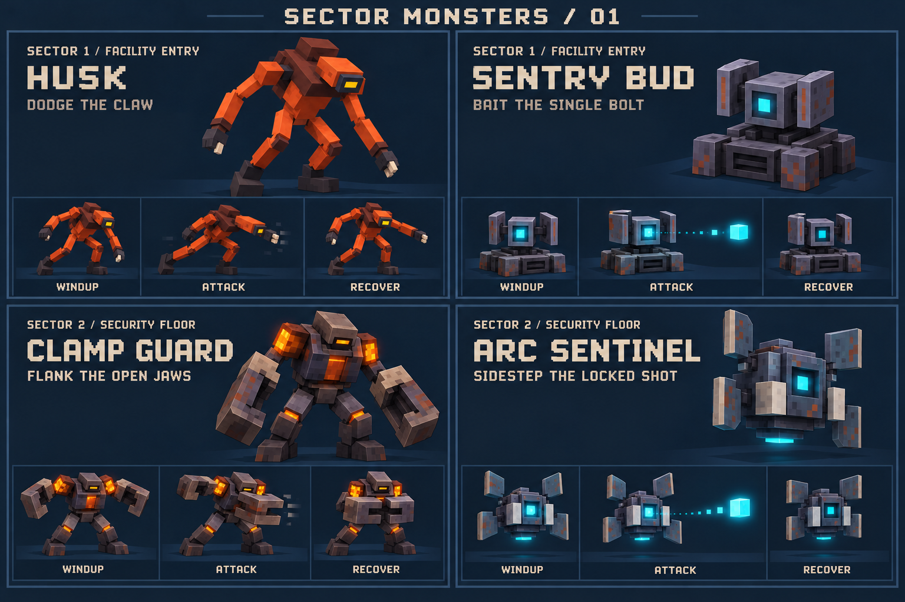
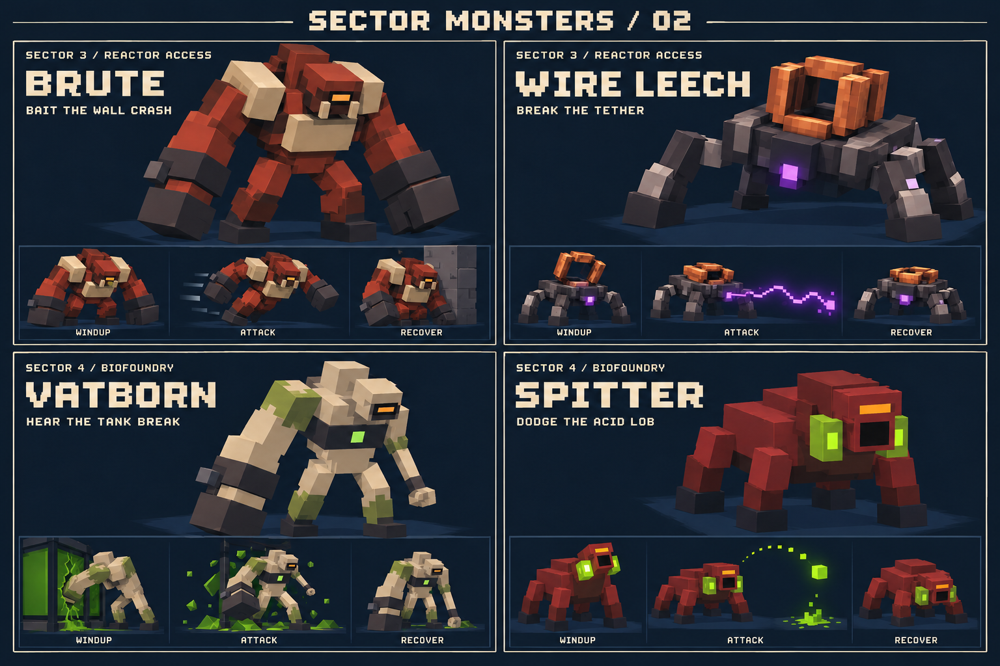
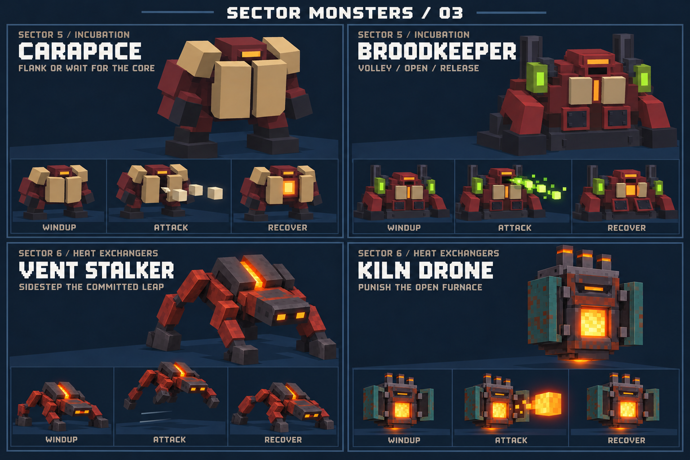
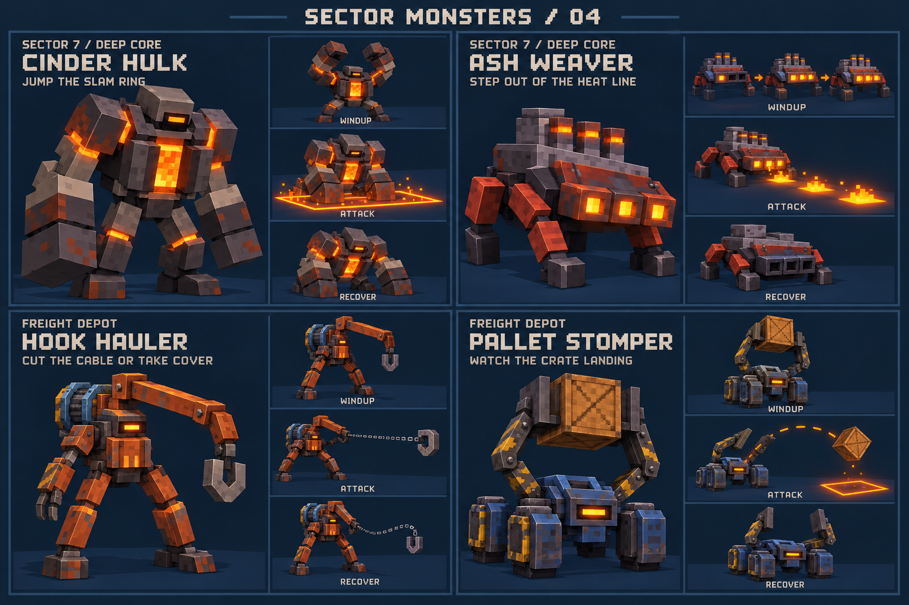
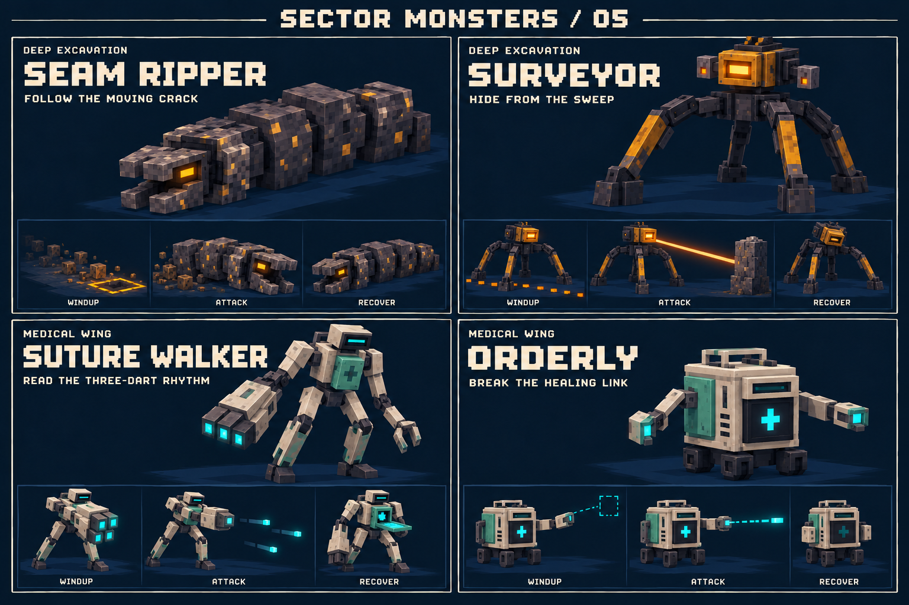

# Sector monster identities — concept pack v2

Created 2026-10-23 with the built-in imagegen tool. **Design references and proposed gameplay, not implemented monsters or screenshots.** This pack responds to the owner's request that each sector have different monsters, behaviour and attack patterns.

Start with [Claude handoff](CLAUDE_HANDOFF.md), then [behaviour specification](BEHAVIOURS.md). [Exact generation prompts](PROMPTS.md) are included for future art revisions.

## Scope and roster

Each row has its own two-monster roster and a different combat decision. Preserve these differences in code; changing colors or increasing HP does not implement this design.

| Sector / map identity | Monsters | Main combat decision | Sheet |
| --- | --- | --- | --- |
| Campaign 1: Facility Entry | Husk; Sentry Bud | Dodge a claw; bait one slow bolt | [01](01-facility-entry-security.png) |
| Campaign 2: Security Floor | Clamp Guard; Arc Sentinel | Change angle; sidestep a locked shot | [01](01-facility-entry-security.png) |
| Campaign 3: Reactor Access | Brute; Wire Leech | Bait a wall crash; break a tether | [02](02-reactor-biofoundry.png) |
| Campaign 4: Biofoundry | Vatborn; Spitter | React to tank breakout; leave acid landing zones | [02](02-reactor-biofoundry.png) |
| Campaign 5: Incubation | Carapace; Broodkeeper | Flank armor; exploit boss openings | [03](03-incubation-heat-exchangers.png) |
| Campaign 6: Heat Exchangers | Vent Stalker; Kiln Drone | Sidestep a leap; punish an exposed furnace | [03](03-incubation-heat-exchangers.png) |
| Campaign 7: Deep Core | Cinder Hulk; Ash Weaver | Jump a slam ring; step out of heat lines | [04](04-deep-core-freight.png) |
| Freight Depot | Hook Hauler; Pallet Stomper | Break a cable; watch the cargo landing | [04](04-deep-core-freight.png) |
| Deep Excavation | Seam Ripper; Surveyor | Read an emergence trail; use real cover against a laser sweep | [05](05-excavation-medical.png) |
| Medical Wing | Suture Walker; Orderly | Read a dart rhythm; prioritize a finite healing source | [05](05-excavation-medical.png) |

The first three sector subtitles describe encounter identities within the existing Facility theme; they do not require three additional map themes. Sectors 4–5 remain Biofoundry and 6–7 remain Geothermal in the current campaign. The three new map names are **not** new campaign sector numbers. Do not silently rename Medical Wing to sector 7 or append sectors 8–10. Its old environment concept image has an obsolete illustrative sector label.

The six-environment rotation and every-fifth-depth Biofoundry boss can remain. Normal campaign rosters should follow the numbered rows; Survival and endless encounters need explicit roster-band selection as described in the handoff. Coolant Works, Security Nexus and Extraction Hangar are outside this pack.

## Artwork

### Sheet 01 — sectors 1–2

### Sheet 02 — sectors 3–4

### Sheet 03 — sectors 5–6

### Sheet 04 — sector 7 and Freight Depot

### Sheet 05 — Excavation and Medical

## Existing versus proposed

Existing runtime identities: Husk, Arc Sentinel, Brute, Vatborn, Broodkeeper, Vent Stalker, Kiln Drone and Cinder Hulk. Their roster restrictions and the tuning in this pack are proposals; the runtime currently mixes several species across sectors.

Spitter and Carapace already have earlier concept references, but are not current `EnemyKind` values. Sentry Bud, Clamp Guard, Wire Leech, Ash Weaver and the six Freight/Excavation/Medical monsters are new proposals. This pack contains **20 identities: 8 existing and 12 proposed runtime additions**.

## Visual implementation contract

- Preserve the large silhouette, distinctive limbs, color blocks, windup, attack and recovery poses. In particular, do not turn the drilling worm, tripod-style scanner, cargo thrower or healing cabinet into reskinned Husks.
- Generated surface wear and tiny fittings are illustrative. Use procedural box rigs, group pivots and a small flat palette; preserve the established pixel rendering. The images are not runtime textures or sprite sheets.
- The selected Ash Weaver and Surveyor illustrations show four-foot support layouts. Use four legs for these selected designs, even though the exploratory prompts requested three. Behaviour does not depend on leg count.
- Keep the Vatborn's oversized **anatomical right arm**; do not mirror it or give it two large arms. Keep the Broodkeeper fixed in its cradle.
- Target 16–28 large boxes for a new ordinary rig, ceiling 32; boss target 50–64. Existing approved rigs may retain their documented budgets. Bake static parts by material/pivot. Target 6–10 rendered draws per ordinary enemy, ceiling 12; test the complete scene, not just individual rigs.
- Color alone must never communicate an attack. Pair every emitter change with a pose, sound and/or ground mark. Keep exit green and keycard red reserved for their established meanings.

The exact numerical behaviour and implementation checks are in [BEHAVIOURS.md](BEHAVIOURS.md). If the small pose strip differs from that specification, keep the large model's silhouette and implement the explicit timing/counterplay in Markdown.
