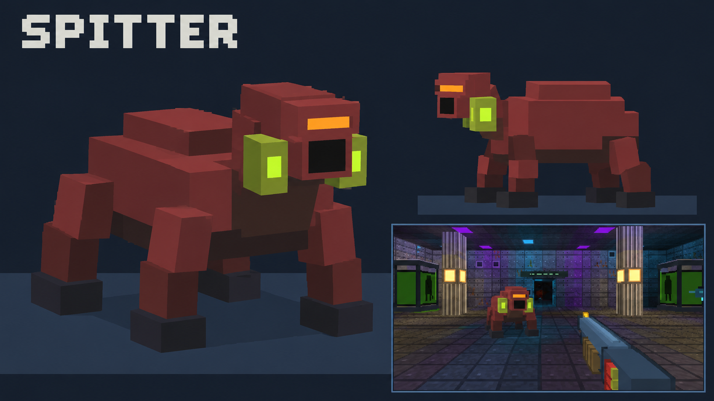
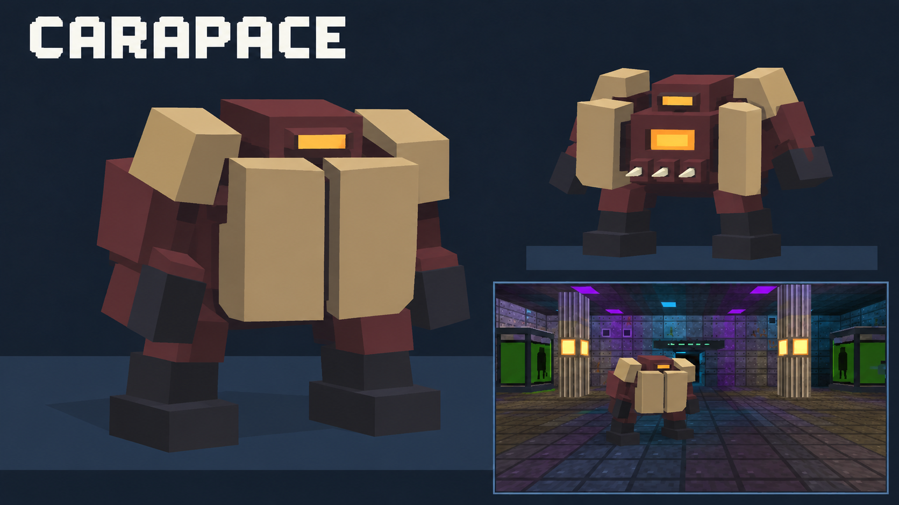
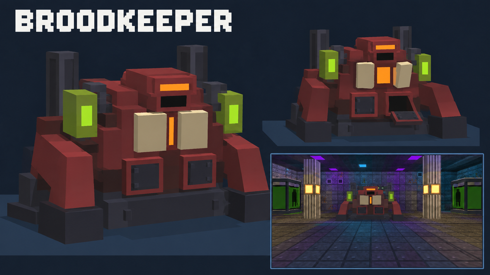
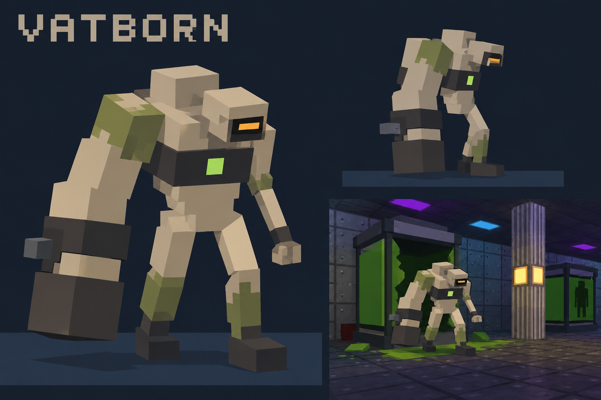

# Sector 4: Biofoundry monster behavior

Status: the **Broodkeeper is implemented** (2026-10-18): it guards the red keycard in campaign sector 5 and on every fifth endless depth, solo only, in web and Poki builds, with the cycle, timings and damage windows below (acid globs are plain projectiles: no lingering patches yet). The Spitter and Carapace are still proposals and are not in the campaign or the Poki build. The Biofoundry is campaign sectors 4–5, generated fresh each run. All timings, health values, and damage below are starting points for playtesting, not measured balance results.

## Roster and references

| Monster | Role | Reference |
| --- | --- | --- |
| Spitter | Ranged pressure and short-lived floor hazards | [Concept](sector4-spitter.png) |
| Carapace | Armored advance; rewards flanking and attack timing | [Concept](sector4-carapace.png) |
| Broodkeeper | Stationary incubation-chamber boss | [Concept](sector4-broodkeeper.png) |
| Vatborn | Contained specimen that breaks out into melee combat | [Concept](sector4-vatborn.png) |

The Vatborn is the creature inside the ordinary specimen tanks. Keep most tanks empty, inert, or visibly damaged; only selected occupied tanks can release one. Spitters occupy the laboratory floor, Carapaces guard containment routes, and the Broodkeeper stays in its dedicated chamber.

## Shared visual and combat rules

- Build the models from large cuboids with flat colors and a few moving joints. Aim for roughly 20–25 parts per regular enemy and 35–45 for the boss; simplify the generated art where needed.
- Preserve the current game's coarse rendering. Recognizable silhouettes, poses, and bright attack cues matter more than small surface details.
- Pair each visual warning with a distinct sound. Color alone must not be required to identify an incoming attack.
- Ranged attacks need line of sight and must collide with walls, doors, and pillars. No homing projectiles or damage through cover.
- Lock attack direction before the strike or projectile release. Allow players to dodge after the warning begins.
- Keep recovery windows readable. Introduce each enemy alone before mixing their roles.
- Keep spawn counts and persistent hazards bounded. No unavoidable tank explosions, instant contact damage, or infinitely growing enemy waves.

## Spitter

**Appearance:** low, four-legged burgundy body with a raised head and two green throat glands. The glands brighten before an acid shot.

**Purpose:** make the player change position without blocking an entire room. It is a ranged enemy, distinct from the explosive Ticker.

**Behavior loop:** idle or patrol → notice player → seek firing distance → charge glands → spit → recover → reposition.

1. Try to stay about 7–12 world units from the target. If the player closes within 4 units, retreat toward a reachable open position.
2. Stop walking, raise the head, and swell/brighten both glands for **0.8 seconds**, accompanied by a wet bubbling sound.
3. Aim at the player's current location at the end of that warning and launch **one visible, non-homing acid glob**. Use a shallow arc; the displayed projectile trajectory must match its collision trajectory.
4. Recover for **1.4 seconds**, glands dim, before choosing another firing position. Retreat attempts time out rather than leaving the enemy stuck against a wall.
5. A glob hitting the floor leaves a small, clearly outlined acid patch for **3 seconds**. A wall hit splashes and disappears; do not create a patch through the wall.

**Starting tuning:** 60 HP; 12 damage on a direct hit; patch radius 0.9 units; patch damage 5 every 0.5 seconds while standing inside. Limit each Spitter to one live patch and the encounter to three. Overlapping patches apply only the strongest patch's damage tick.

**Counterplay:** sidestep after the aim locks, use pillars to catch shots, and close during recovery. A shotgun hit while it is charging can interrupt the shot; start with a single interrupt per charge, not a permanent stun lock.

**Placement:** side lanes of the specimen laboratory or waste-processing room. Never cover the only doorway with multiple fresh patches. Supply a clean movement lane.

## Carapace

**Appearance:** squat upright body, two large pale front plates, recessed amber eye, dark legs, and an orange core behind the plates. Its sides and back remain burgundy and visibly unarmored.

**Purpose:** reward changing angle or waiting for a clear opening. It should not feel like a larger health bar on a Husk.

**Behavior loop:** guarded advance → plant feet → open plates → spike volley → exposed recovery → close plates → advance.

1. Advance slowly while facing the target. Turn deliberately so a flank remains possible; do not instantly snap toward a player circling behind it.
2. At 4–9 units with line of sight, plant both feet. A shell scrape and outward plate movement warn of the attack for **0.9 seconds**.
3. Lock its facing, expose the orange core, and release **three slow spike projectiles** in a narrow horizontal fan. The fan leaves room to sidestep or take cover.
4. Keep the plates open for **1.2 seconds** after firing. Then close them over **0.35 seconds** before advancing again.
5. Inside melee range, use a separate **0.7-second** body-shove warning followed by one short strike, with **1 second** of recovery. No repeated contact damage from touching its model.

**Starting tuning:** 100 HP; closed front plates take 25% of normal damage; exposed core takes 2× normal damage; sides/back take normal damage. Each spike deals 8 damage; shove deals 14. These multipliers depend on the actual hit location and plate state, not just the camera's approximate angle.

**Counterplay:** flank its slow turn, wait for the orange core, or place rocket splash behind it. Splash still requires an unobstructed path from the explosion to the body; front armor is not bypassed merely by choosing a weapon. The Arc Caster can chain to it but receives no arbitrary armor exemption.

**Placement:** wider containment rooms with two approaches. First introduce one without a Spitter nearby. Later, one Carapace plus one Spitter creates a movement-and-timing encounter.

## Broodkeeper

**Appearance:** a broad burgundy organism fixed into a low steel incubation cradle. Two side reservoirs glow green; two pale chest plates guard an orange core. Two abdominal hatch doors release creatures. It has bracing forelimbs and no walking legs.

**Purpose:** a repeatable, readable boss that combines projectile dodging, target prioritization, and a useful damage window.

**Arena:** put the cradle against the far wall of the incubation chamber. Keep a broad route around at least two cover pillars, a clear entrance threshold, and supplies at the sides. Activate the encounter only after the player has entered; do not attack during the preview menu or spawn the boss on the arrival point.

**Repeating pattern:** acid volley → exposed core → release specimens → exposed core → repeat.

1. **Acid volley:** side reservoirs brighten and the head draws back for **1 second**. Fire three visible acid globs, **0.35 seconds apart**, with direction locked just before each shot. Players can keep strafing or change cover. Use the same bounded patch rules as the Spitter, with a total of three boss patches.
2. **First opening:** reservoirs dim, chest plates open, and the orange core stays exposed for **2.4 seconds**. The boss launches no new attack during this window; existing projectiles and specimens can still be active.
3. **Release specimens:** close chest plates. Abdominal hatches rattle and open over **1 second**, then release at most two creatures into marked clear spots in front of the cradle. For an initial implementation, reuse existing Husks; a separate hatchling model is optional later. Do not release full-size Carapaces or tank-bound Vatborn from these small hatches.
4. **Second opening:** leave the core exposed for **3 seconds**, then close it and restart the cycle. Cap active summoned creatures at four. If the cap is reached, skip the release and still give the opening. Never spawn into a player, wall, closed door, or occupied spot.
5. **Below 40% health:** increase the acid volley from three to five shots, but preserve the warning and both core openings. Keep the patch and summon caps. Increase pressure through the pattern rather than removing counterplay.

**Starting tuning:** 600 HP; each acid glob deals 14 damage. Closed armor takes 25% of normal damage; the exposed core takes 2× normal damage. No regeneration. Final health should be tested against the ammunition supplied in the actual room.

**Counterplay:** dodge the volleys, use the Arc Caster to clear summoned Husks, then aim accurate fire at the core. Scattergun and rockets reward committing during an opening; the Sidearm remains useful if ammunition runs low.

**Defeat:** stop attack scheduling, cancel queued summons, remove remaining damaging acid, and close any outstanding spawn effects. After a short collapse, open the chamber's lift-access gate. Keep surviving summons visible and defeatable, but do not require hunting a stuck summon to complete the sector. The eventual narrative can play after the player rides the lift; this is not wired into the current preview yet.

## Vatborn: the tank occupant

**Appearance:** pale gray-beige hunched adult mutant with olive tank stains, a narrow amber eye, a chest restraint band, and one oversized right forearm. The opposite arm stays thin. Broken wrist hardware identifies it as an escaped specimen rather than an armored guard.

**Purpose:** make selected tanks an understandable environmental threat. After breakout it becomes a short-range melee opponent; it does not spit acid or explode.

**Behavior loop:** dormant in tank → visible agitation → breach → step out → pursue → heavy swing → recover.

1. **Dormant:** show its silhouette through the green panel. Occupied tanks have a small amber status light; empty tanks remain dark. Pick occupied tanks when the level is created, not randomly when the player walks past.
2. **Wake trigger:** shooting its tank or activating a nearby containment alarm wakes it. Introduce the first Vatborn with a deliberate alarm event in view of the player. Later occupied tanks may wake to nearby loud combat, but still use the full warning sequence.
3. **Agitation:** the silhouette moves, the status light blinks, and the glass knocks audibly for **1.2 seconds**. Then the creature pushes out the front panel. Do not deal damage during the warning or glass break.
4. **Breach:** open an actual collision gap in the tank before moving the monster. Allow **0.8 seconds** for it to step onto a verified clear floor position. If the exit is blocked by a player or another enemy, wait or choose another nearby valid position; never teleport on top of the obstruction.
5. **Pursuit:** shamble at moderate speed. After seeing the player for a moment, it may use a short **0.6-second** forward rush, followed by **1 second** of slower movement. Rush is movement only, with no automatic contact damage and no wall phasing.
6. **Heavy swing:** inside roughly 1.6 units, plant feet and raise the oversized arm with a restraint clank for **0.65 seconds**. Lock facing, swing once, and recover for **1.1 seconds**. Check range and line of sight at impact; moving around a pillar cancels a hit that would pass through it.

**Starting tuning:** 55 HP; heavy swing deals 16 damage. Exposed head follows the current humanoid headshot rules. The green chest mark is visual identification, not a second weak-point system.

**Counterplay:** notice occupied tanks, trigger one from a safe distance, and use the step-out delay to reposition. Dodge toward its smaller-arm side or back away during the heavy-arm windup. Its long recovery gives the Sidearm and Scattergun a clear opportunity.

**Spawn rules:** one preallocated Vatborn per occupied tank; each tank can release it only once. Reserve a clear standing position and a path into the room. Limit simultaneous newly breaching tanks to two. Destroying a tank never produces a second creature. Killing an exposed Vatborn during its exit must leave the tank permanently empty.

**Placement:** first a single tank with a clear view and room to retreat. Later, place a tank near a side lane while a Spitter pressures another position. Do not put the first occupied tank directly behind the spawn, inside a two-block doorway, or next to an unavoidable barrel chain.

## Encounter progression and implementation boundary

1. Arrival/decontamination: no surprise enemies; establish the ordinary tank appearance.
2. Specimen lab: one controlled Vatborn breakout, followed by a lone Spitter.
3. Waste processing: Spitter with a few existing enemies and useful barrel placements.
4. Containment wing: introduce the Carapace alone, then a mixed encounter in a wider room.
5. Security: keycard alarm wakes a bounded selection of occupied tanks. Mark them visibly before the alarm.
6. Incubation chamber: Broodkeeper with its own capped summons; no extra unexplained ambush wave.
7. Transit lift: supplies and a short clear exit route after the boss.

Implement and tune these in the development-only preview first. Keep all enemy kinds, projectile/acid logic, tank collision changes, checkpoint/retry behavior, and boss-gate changes out of the normal campaign until explicitly integrated. The current tanks are solid scenery: adding Vatborn requires a real breach and collision implementation, not just spawning a mesh inside them. Any later co-op version needs host-owned attacks, one shared tank-occupancy state, synchronized hazard lifetimes, and a single boss-defeat gate event.

## Image provenance

Concepts generated with the built-in imagegen tool using the current enemy lineup and Biofoundry room as visual references. The images are modeling guides, not textures or finished game assets. Exact prompts for the three new sheets are saved in [sector4-monster-prompts.md](sector4-monster-prompts.md).
